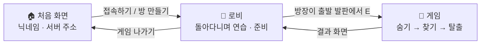
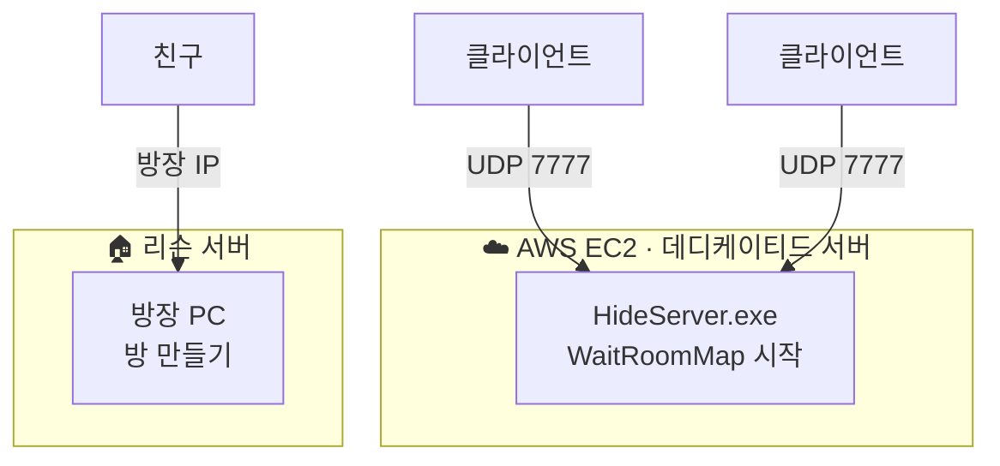
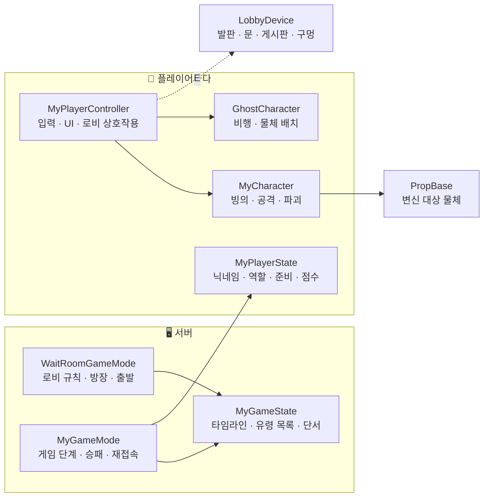

<div align="center">

# 🔍 ChuChuSearch · 쮸쮸서치

**물체로 변신해 숨고, 마법으로 찾아내는 3인칭 멀티플레이 숨바꼭질**

     

  [](https://youtu.be/NzZujXlLXhQ)

[](https://youtu.be/NzZujXlLXhQ)

</div>

---

## 📑 목차

[](#-프로젝트-개요) [](#-게임-한눈에-보기) [](#-주요-기능) [](#-네트워크--서버) [](#-아키텍처) [](#-조작법) [](#-시작하기) [](#-tech-stack) [](#-배운-점)

---

## 📌 프로젝트 개요

   

| 항목 | 내용 |
| --- | --- |
| 🎮 장르 | 3인칭 멀티플레이 숨바꼭질 (술래 vs 러너) |
| 📅 개발 기간 | 2026.04 ~ 2026.12 |
| 👥 개발 인원 | 3인 (**프로그래밍 1인 전담**) |
| 🛠 엔진 / 언어 | Unreal Engine 5.4 · C++ · Blueprint |
| 🌐 네트워크 | 리슨 서버 / 데디케이티드 서버 (AWS EC2) |
| 🗂 형상 관리 | Git · GitHub |

> 3인 팀에서 **유일한 프로그래머**로 게임플레이, 네트워크, UI, 서버 배포까지 프로그래밍 전반을 담당했습니다.

---

## 🎲 게임 한눈에 보기

   



| 역할 | 목표 | 할 수 있는 것 |
| --- | --- | --- |
| 🪄 **술래** | 러너를 모두 찾아 탈락시키기 | 마법 발사, 의심 가는 물체 꾹 눌러 부수기 |
| 🫥 **러너** | 단서 3개 모으고 비밀번호 문을 열어 탈출하기 | 주변 물체로 변신해 숨기, 제자리 고정·회전 |
| 👻 **유령** | 탈락해도 팀 돕기 | 날아다니며 가짜 물체 배치해 술래 속이기 |

**게임 진행 단계**

```text
숨는 시간 ──▶ 1페이즈 ──▶ 강제 교체 ──▶ 2페이즈 ──▶ 피버 타임 ──▶ 결과
 (30초)       (4분)        (30초)        (4분)        (1분)
              술래 추격     같은 물체에    다시 추격    숨은 위치에서
                           계속 숨은 러너               주기적으로 소리
                           는 물체 교체
```

> 시간이 다 지나면 러너 승리, 러너가 모두 탈락하면 술래 승리. 단계 시간과 최대 인원은 방장이 로비에서 바꿀 수 있습니다.

---

## ✨ 주요 기능

    

<details open>
<summary><b>🌾 걸어 다니는 3D 로비</b></summary>

<br>

메뉴 화면 대신 목장 맵을 캐릭터로 돌아다니며 게임을 준비하는 로비입니다.

| 장치 | 동작 |
| --- | --- |
| 🟠 **출발 발판** | 위에 서면 준비 완료. 방장이 발판에서 **E** → 3초 카운트다운 후 출발 |
| 🔴🟢 **역할 문** | **E**로 술래·러너 지망. 지망한 역할로 로비에서 바로 연습 |
| 🟣 **게임 설정 게시판** | 단계 시간·최대 인원 설정 (방장만 변경, 나머지는 보기) |
| ⚫ **유령 구멍** | 유령이 되어 물체 배치를 미리 체험하고 다시 사람으로 복귀 |

- **연습 규칙**: 맞아도 탈락 없이 피격 효과만, 부서진 물체는 5초 뒤 같은 자리에 다시 생성
- **머리 위 이름표**: 역할 지망에 따라 색이 바뀌고 방장·준비 상태 표시
- **처음 안내**: 장치에 처음 다가가거나 역할이 바뀔 때 한 번만 뜨는 안내
- **Tab** 참가자 목록, **Enter** 채팅

</details>

<details>
<summary><b>🫥 물체 변신(빙의) 시스템</b></summary>

<br>

- 바라보는 물체에 테두리 표시(커스텀 뎁스 스텐실 + 후처리 아웃라인)
- 변신하면 캐릭터 충돌을 물체 크기에 맞추고, 같은 팀이 숨은 물체는 부술 수 없음
- **고정(T)** 후 **Q/E**로 회전, **R**로 똑바로 세우기
- 1페이즈 내내 같은 물체에 숨어 있던 러너는 강제 교체 단계에서 다른 물체로 옮겨야 함

</details>

<details>
<summary><b>🪄 술래 공격 · 물체 파괴</b></summary>

<br>

```text
좌클릭 ──▶ 투사체 발사 ──▶ 충돌 판정 ─┬─▶ 러너 적중 ──▶ 하트 감소 / 탈락
                                     └─▶ 물체 적중 ──▶ 유령이 놓은 가짜면 유령 점수
좌클릭 꾹(3초) ──▶ 서버 거리·시야 검증 ──▶ 물체 파괴 ──▶ 숨은 러너면 적중 / 단서 등장 / 유령 배치 목록 등록
```

- 서버에서 사거리와 시야를 다시 검사해 벽 너머 파괴 차단
- 적중 시 카메라 흔들림, 피격 화면 효과, 3D 사운드

</details>

<details>
<summary><b>👻 유령 · 🔑 단서 · 🚪 탈출</b></summary>

<br>

- **유령**: 탈락한 러너는 유령이 되어 부서진 물체를 골라 다시 놓아 술래를 속임 (물체 썸네일 버튼)
- **단서**: 특정 물체를 부수면 단서가 등장, 러너가 모아 비밀번호를 알아냄
- **비밀번호 문**: 단서 3개를 모은 러너가 비밀번호를 풀고 특별 출구로 탈출하면 러너 승리

</details>

<details>
<summary><b>🏆 점수 · 관전 · 시간 끌기 방지</b></summary>

<br>

- **점수**: 적중·탈락·단서·비밀번호·코앞에서 숨기·아슬아슬하게 피하기·가짜 물체 적중·승리
- 게임 중에는 상대 팀 점수를 숨기고 결과 화면에서 공개
- **관전(V)**: 탈락 후 다른 플레이어 시점 관전
- **피버 타임**: 숨은 러너 위치에서 주기적으로 소리를 내 멀리서 버티기 방지

</details>

<details>
<summary><b>🎨 C++로 그린 UI</b></summary>

<br>

처음 화면, 로비 HUD, 채팅·참가자 목록, 설정 창, 점수판, 조작법 안내, 결과 화면 등
대부분의 UI를 **위젯 블루프린트 없이 C++(UMG)로 직접 구성**했습니다.

- 같은 톤의 크림색 패널·리본 제목·둥근 버튼을 코드로 통일
- 마우스 감도·상하 반전, 그래픽, 음량(마스터·배경음·효과음) 설정과 탭별 초기화
- 맵이 바뀌어도 끊기지 않는 배경음(`GameInstanceSubsystem`)

</details>

---

## 🌐 네트워크 & 서버

    



- **두 가지 방식을 한 클라이언트로**: 전용 서버 주소로 접속하거나, 내 PC로 방을 열 수 있음
- **방장 자동 지정**: 먼저 들어온 사람이 방장, 방장이 나가면 다음 사람에게 넘어감
- **맵 이동**: 로비 → 게임은 Seamless Travel, 게임 → 로비는 재접속 방식으로 상태를 깨끗하게 초기화
- **재접속 복원**: 게임 중 끊긴 플레이어가 돌아오면 역할·단서·캐릭터 복원 (팀 전원 이탈 시 60초 유예)
- **서버 권한 검증**: 빙의·파괴·공격·닉네임·채팅을 서버에서 다시 검사 (도배·사칭 방지)
- **접속 안내**: 방이 가득 참, 게임 진행 중, 버전 불일치, 연결 끊김을 구분해 팝업 안내, 접속 취소 지원

---

## 🧱 아키텍처

  



<details>
<summary><b>📂 주요 C++ 클래스</b></summary>

<br>

| 분류 | 클래스 | 역할 |
| --- | --- | --- |
| **Game Flow** | `AWaitRoomGameMode` | 로비 규칙, 방장 지정, 출발 조건, 연습 규칙 |
| | `AMyGameMode` | 게임 단계 진행, 승패, 재접속, 점수 |
| | `AMyGameState` | 단계 타임라인, 유령 배치 목록, 단서 정보 |
| | `AMyPlayerState` | 닉네임, 역할 지망, 준비, 점수 |
| **Gameplay** | `AMyPlayerController` | 입력, UI, 로비 장치 상호작용, 배경음 |
| | `AMyCharacter` | 빙의, 술래 공격, 물체 파괴, 피격 |
| | `AGhostCharacter` | 유령 비행, 물체 배치 미리보기 |
| | `APropBase` | 변신 대상 물체 공통 기능 |
| | `ASeekerProjectile` | 술래 투사체와 충돌 처리 |
| | `APasswordDoor` / `ACluePickup` | 비밀번호 문, 단서 |
| **Lobby** | `ALobbyDevice` 외 4종 | 출발 발판, 역할 문, 설정 게시판, 유령 구멍, 구역 표지판 |
| **UI** | `UTitleWidget`, `ULobbyHudWidget`, `ULobbyPanelWidget` 등 | C++로 만든 UMG 위젯 |
| **System** | `UMusicSubsystem`, `UConnectionNoticeSubsystem` | 맵을 넘는 배경음, 접속 실패 안내 |
| **Tool** | `UPropIconCommandlet` | 물체 썸네일 자동 생성 (에디터 전용) |

</details>

---

## 🎮 조작법

 

| 공통 | | 러너 | | 술래 | | 유령 | |
| :-: | --- | :-: | --- | :-: | --- | :-: | --- |
| `WASD` | 이동 | `F` / 우클릭 | 물체에 숨기·나오기 | 좌클릭 | 마법 발사 | `Space` / `Ctrl` | 위 / 아래 |
| `Space` | 점프 | `T` | 제자리 고정 | 좌클릭 꾹 | 물체 파괴 | 아이콘 클릭 | 물체 고르기 |
| `Tab` | 점수판 · 참가자 | `Q` / `E` | 고정 중 회전 | | | 좌클릭 | 물체 놓기 |
| `H` | 조작법 안내 | `R` | 똑바로 세우기 | | | `R` | 목록 새로고침 |
| `ESC` / `F10` | 설정 | 우클릭 | 비밀번호 입력 | | | `V` | 관전 |
| `E` | 로비 장치 | | | | | | |
| `Enter` | 로비 채팅 | | | | | | |

---

## 🚀 시작하기

  

### 요구 사항

- Windows 10/11
- Unreal Engine **5.4** (데디케이티드 서버 빌드는 **소스 빌드 엔진** 필요)
- Visual Studio 2022 (C++ 게임 개발 워크로드)

### 빌드 & 실행

```powershell
# 1) 저장소 받기
git clone https://github.com/ChuChuSearch/ue5-chuchusearch-hideandseek.git

# 2) Hide.uproject 우클릭 → Generate Visual Studio project files → 에디터 빌드 후 실행
```

| 방식 | 방법 |
| --- | --- |
| 🧪 에디터 테스트 | Play 옵션 **Number of Players 2+**, **Play As Listen Server** |
| 🏠 리슨 서버 | 클라이언트 실행 → 닉네임 입력 → **방 만들기** (UDP 7777 허용 필요) |
| ☁️ 데디케이티드 | `HideServer` 패키징 → `HideServer.exe -log` → 클라이언트에서 서버 주소로 **접속하기** |

> 처음 화면의 기본 서버 주소는 `Config/DefaultGame.ini`의 `[Hide.Title] DefaultServerAddress`에서 바꿀 수 있습니다.

---

## 🛠 Tech Stack

        

---

## 💡 배운 점

   

- **서버 권한 기반 멀티플레이 설계**: 클라이언트 요청을 서버에서 다시 검증하고, 필요한 정보만 필요한 사람에게 복제(상대 팀 점수, 비밀번호 정답 등)
- **Game Framework 역할 분리**: GameMode · GameState · PlayerState · PlayerController · Character의 책임을 나눠 기능이 늘어도 구조를 유지
- **리슨/데디케이티드 겸용 구조**: 서버가 플레이어가 아닐 수 있다는 전제로 방장·사운드·UI 로직 작성
- **맵 이동과 상태 관리**: Seamless Travel과 재접속 이동의 차이, 맵을 넘는 데이터(`GameInstance`/`LocalPlayer` 서브시스템)
- **코드로 만드는 UI**: 위젯 블루프린트 없이 C++로 UMG를 구성해 디자인 톤 통일과 유지보수성 확보
- **에디터 자동화**: 에디터 스크립트·커맨드렛으로 맵 배치, 메시 분리, 충돌 생성, 썸네일 제작 같은 반복 작업 자동화
- **클라우드 배포**: AWS EC2에 데디케이티드 서버를 올리며 보안 그룹·방화벽·포트 구성 경험

---

## 📋 개발 현황


현재 개발 진행 중이며, README는 **구현이 완료된 기능을 기준으로** 작성합니다.

<div align="center">

<sub>Made with ❤️ and Unreal Engine by the ChuChuSearch team</sub>

</div>
